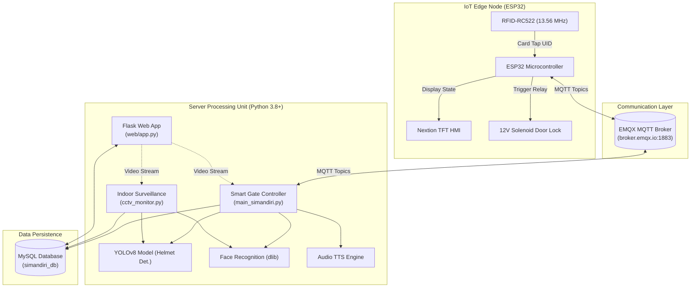
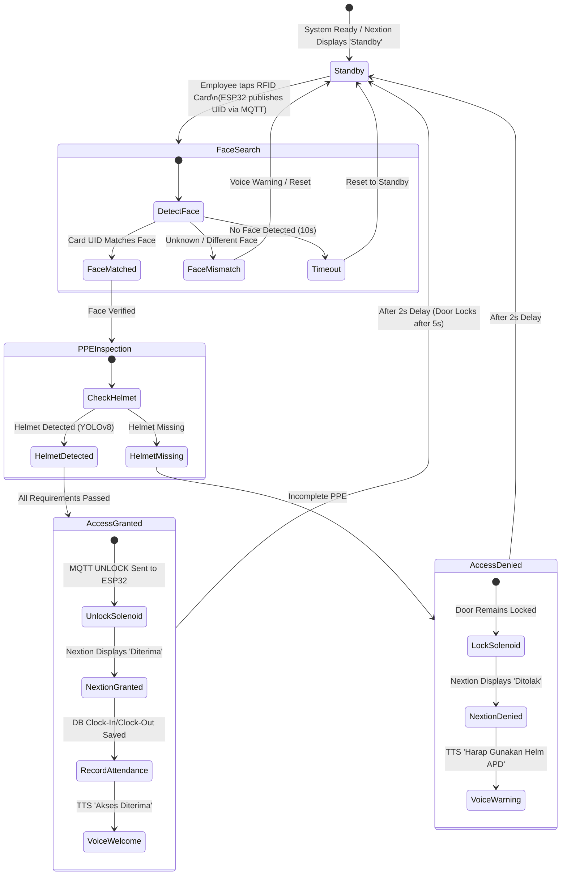

# SIMANDIRI - Autonomous & Integrated Industrial Safety and Security System

<p align="center">
  
</p>

<p align="center">
  <b>An AIoT-Powered Industrial Safety & Access Control Solution</b><br>
  Dual-Factor Authentication • Automated PPE (Helmet) Compliance Inspection • Real-Time Workplace CCTV Surveillance
</p>

---

## 📌 Overview

**SIMANDIRI** (*Sistem Keamanan Mandiri & Terintegrasi*) is an intelligent industrial safety and access management prototype combining **Internet of Things (IoT)**, **Computer Vision**, and **Deep Learning**. 

The system enforces workplace discipline and occupational health and safety (K3 / OSH) compliance through:
1. **Dual-Factor Identity Verification**: Combining RFID access card scanning and biometric face recognition to eliminate attendance fraud (buddy punching).
2. **Automated PPE Compliance Inspection**: Using custom-trained **YOLOv8** object detection models to ensure employees wear required Personal Protective Equipment (PPE / APD), specifically safety helmets, before granting physical door/gate access.
3. **Continuous Indoor CCTV Monitoring**: Passively tracking workers inside operational zones in real-time, alerting safety officers and issuing automated voice reprimands whenever PPE is removed.
4. **Centralized Web Dashboard**: Providing safety managers with live video feeds, real-time access logs, daily attendance reports, and violation analytics.

---

## ✨ Key Features

- 🔐 **Dual-Factor Authentication**: Mifare 13.56MHz RFID card tap paired with facial biometric recognition.
- ⛑️ **AI-Powered PPE Inspection**: Sub-second helmet compliance verification powered by an optimized YOLOv8 neural network.
- 🚪 **Integrated Smart Gate Control**: Seamless lock/unlock control of physical 12V solenoid door locks via ESP32 using low-latency MQTT messaging.
- 📹 **Intelligent Indoor CCTV Surveillance**: Passive multi-face detection and PPE tracking that detects violations on the plant floor with configurable debouncing and cooldown mechanisms.
- 🔊 **Multi-Modal Interactive Feedback**:
  - **Visual Feedback**: Nextion TFT Touchscreen HMI displaying real-time operational states (`Standby`, `Verification`, `Access Granted`, `Access Denied`).
  - **Audio Feedback**: Dynamic Text-to-Speech (TTS) audio notifications guiding employees through the verification flow.
- 📊 **Comprehensive Web Dashboard**: Flask-based web interface featuring:
  - Live Gate & CCTV video streaming.
  - Employee profile and RFID card management.
  - Automated daily attendance tracking (Clock-In, Clock-Out, On-Time vs. Late status).
  - Safety violation logs with timestamped snapshot evidence.

---

## 🏗️ System Architecture



---

## 🔄 Gate Verification Workflow



---

## 🔌 Hardware Connections & Wiring

### 1. ESP32 Pin Mapping

| Component | Pin | ESP32 GPIO | Description / Notes |
|---|---|---|---|
| **RFID-RC522** | SDA (SS) | `GPIO 5` | SPI Chip Select |
| | SCK | `GPIO 18` | SPI Clock |
| | MOSI | `GPIO 23` | SPI MOSI |
| | MISO | `GPIO 19` | SPI MISO |
| | RST | `GPIO 27` | Reset Pin |
| | 3.3V | `3.3V` | **Do NOT connect to 5V** |
| | GND | `GND` | Common Ground |
| **Nextion TFT** | TX | `GPIO 16` (RX2) | Hardware Serial 2 Receive |
| | RX | `GPIO 17` (TX2) | Hardware Serial 2 Transmit |
| | VCC | `5V` (or external 5V) | Minimum 500mA supply recommended |
| | GND | `GND` | Common Ground |
| **Relay Module** | IN | `GPIO 26` | Active LOW / HIGH (controls Solenoid) |
| | VCC | `5V` | Relay logic power |
| | GND | `GND` | Common Ground |
| **Solenoid Lock** | 12V+ | External 12V DC Adapter | Powered via Relay COM & NO contacts |

> [!WARNING]
> **Relay & Solenoid Power Isolation**: Solenoid door locks draw significant inductive current (~1A @ 12V) that can generate Electromagnetic Interference (EMI), causing the RC522 RFID reader to freeze. Always power the 12V solenoid using an independent power supply with shared ground.

---

## 📡 MQTT Topic Specifications

Default public broker: `broker.emqx.io:1883` *(Can be modified in `config.py` and `esp32_gerbang.ino`)*

| MQTT Topic | Direction | Payload Example | Description |
|---|---|---|---|
| `simandiri/lukit/rfid/tap` | ESP32 ➔ Server | `{"uid": "A1B2C3D4"}` | Sent when an RFID card is tapped |
| `simandiri/lukit/gate/lock` | Server ➔ ESP32 | `UNLOCK` / `LOCK` | Controls relay state to unlock/lock solenoid |
| `simandiri/lukit/nextion/page` | Server ➔ ESP32 | `Standby` / `Verifikasi` / `Diterima` / `Ditolak` | Switches display page on Nextion TFT |
| `simandiri/lukit/nextion/name` | Server ➔ ESP32 | `John Doe` | Updates employee name string on Nextion |

---

## 💻 Tech Stack & Requirements

### System Requirements
- **Host Machine**: Windows 10/11 or Linux (Ubuntu 20.04+).
- **Processor**: Intel Core i5 / AMD Ryzen 5 or higher.
- **RAM**: Minimum 4GB (8GB+ recommended).
- **GPU (Optional)**: NVIDIA GPU with CUDA support for accelerated YOLOv8 inference.
- **Cameras**: Internal or external USB webcams for Gate and CCTV.
- **Microcontroller**: ESP32 DevKit v1.

### Software Dependencies
- **Python**: 3.8 to 3.11
- **Database**: MySQL Server 8.0+ / MariaDB (e.g., via XAMPP)
- **Arduino IDE**: 2.0+ with ESP32 board package installed

---

## 🚀 Installation & Setup

### 1. Clone the Repository
```bash
git clone https://github.com/your-username/simandiri_lomba_iot.git
cd simandiri_lomba_iot
```

### 2. Set Up Python Virtual Environment
```bash
# Windows
python -m venv venv
venv\Scripts\activate

# Linux / macOS
python3 -m venv venv
source venv/bin/activate
```

### 3. Install Python Dependencies
```bash
pip install --upgrade pip
pip install -r requirements.txt
```

> [!NOTE]
> **Windows `dlib` Installation**: If `pip install dlib` or `face-recognition` fails on Windows due to CMake / Visual C++ Build Tools requirements, install a precompiled wheel for your Python version, e.g.:
> ```bash
> pip install https://github.com/z-mahmud22/Dlib_Windows_Python3.x/raw/main/dlib-19.24.1-cp310-cp310-win_amd64.whl
> ```

### 4. Database Initialization
1. Start your MySQL service (e.g., via **XAMPP Control Panel** or local MySQL service).
2. Ensure credentials in `config.py` match your MySQL setup:
   ```python
   MYSQL_CONFIG = {
       'host': 'localhost',
       'port': 3306,
       'user': 'root',
       'password': '',
       'database': 'simandiri_db'
   }
   ```
3. The database `simandiri_db` and required tables (`pegawai`, `absensi`, `pelanggaran_apd`, `cctv_log`) will be created automatically upon the first script execution.

### 5. Register Employee Facial Dataset
1. Place 3 to 5 clear, well-lit portrait photos for each employee in:
   ```text
   dataset_wajah/
   ├── John_Doe/
   │   ├── 1.jpg
   │   ├── 2.jpg
   │   └── 3.jpg
   └── Jane_Smith/
       ├── 1.jpg
       └── 2.jpg
   ```
2. Supported extensions: `.jpg`, `.jpeg`, `.png`, and `.heic` (iOS photos).

---

## ⚙️ Configuration (`config.py`)

All primary operating parameters are centralized in [`config.py`](file:///c:/Users/lukit/Downloads/LOMBA/SIMANDIRI/simandiri_lomba_iot/simandiri_lomba_iot/config.py):

| Parameter | Default Value | Description |
|---|---|---|
| `YOLO_MODEL_PATH` | `runs/detect/simandiri_apd_v2/weights/best.pt` | Path to trained YOLOv8 model weights |
| `GATE_REQUIRED_APD` | `["helm"]` | Mandatory PPE list verified at the gate |
| `GATE_CAMERA_INDEX` | `1` | Camera index for the smart gate (`0` for internal, `1` for USB external) |
| `CCTV_CAMERA_INDEX` | `1` | Camera index for indoor CCTV |
| `FACE_TOLERANCE` | `0.55` | Biometric match strictness (Lower = stricter) |
| `YOLO_CONFIDENCE` | `0.25` | Minimum confidence threshold for YOLOv8 |
| `DOOR_UNLOCK_DURATION` | `5` | Seconds the solenoid lock remains open |
| `RFID_FACE_TIMEOUT` | `10` | Timeout in seconds waiting for face match after RFID tap |
| `SHIFT_START_TIME` | `"08:00:00"` | Daily threshold for "On-Time" vs "Late" status |
| `MQTT_BROKER_HOST` | `'broker.emqx.io'` | MQTT Broker host address |

---

## 🎮 Execution Guide

### Step 1: Flash the ESP32 Firmware
1. Open [`arduino/esp32_gerbang/esp32_gerbang.ino`](file:///c:/Users/lukit/Downloads/LOMBA/SIMANDIRI/simandiri_lomba_iot/simandiri_lomba_iot/arduino/esp32_gerbang/esp32_gerbang.ino) in Arduino IDE.
2. Install required Arduino libraries via Library Manager:
   - `PubSubClient` by Nick O'Leary
   - `MFRC522` by GithubCommunity
3. Update `WIFI_SSID` and `WIFI_PASSWORD` with your network details.
4. Select board **ESP32 Dev Module** and the correct COM port, then click **Upload**.

### Step 2: Start the Web Dashboard
```bash
python web/app.py
```
Open your browser and navigate to:
```
http://localhost:5000
```
- Access live camera streaming.
- Add and manage employees and bind their RFID card UIDs.
- View real-time attendance rosters and PPE violation records.

### Step 3: Run the Smart Gate Controller
```bash
python main_simandiri.py
```
- Activates gate camera feed, loads facial encodings, and connects to MQTT broker.
- Ready to receive RFID tap events, perform face recognition, verify helmet presence, and command the gate solenoid.

### Step 4: Run the Indoor CCTV Surveillance
Open a new terminal window:
```bash
python cctv_monitor.py
```
- Continuously scans active work areas.
- Identifies registered workers and monitors helmet wearing compliance.
- Triggers audio warnings and records violation logs if a worker removes their helmet inside the work area.

---

## 🧠 Model Training (Optional)

To train or fine-tune the YOLOv8 PPE detection model on custom data:
```bash
python train_model.py
```
- Dataset configuration: `dataset_apd/data.yaml`
- Select between fine-tuning existing weights or training from base `yolov8s.pt`.
- Automatically outputs model weights and performance metrics to `runs/detect/`.

---

## 📂 Project Directory Structure

```text
simandiri_lomba_iot/
├── arduino/
│   └── esp32_gerbang/
│       └── esp32_gerbang.ino       # ESP32 firmware (RFID, Nextion, Relay, MQTT)
├── dataset_apd/                     # PPE training dataset (YOLO format)
│   └── data.yaml                   # Dataset classes & paths configuration
├── dataset_wajah/                   # Employee face biometric photo repository
├── img/                             # Project logos and image assets
├── runs/                            # YOLO training runs and model weights
│   └── detect/simandiri_apd_v2/weights/best.pt
├── web/                             # Flask Web Application
│   ├── app.py                      # Flask routes and video streaming server
│   ├── static/                     # CSS, JavaScript, and UI icons
│   └── templates/                  # Jinja2 HTML templates (Dashboard, Attendance, etc.)
├── cctv_monitor.py                  # Real-time indoor CCTV monitoring service
├── config.py                        # Central system configuration
├── database.py                      # MySQL database manager & auto-migration
├── main_simandiri.py                # Smart Gate Controller (RFID + Face + PPE)
├── requirements.txt                 # Python package dependencies
├── train_model.py                   # YOLOv8 PPE model training script
└── README.md                        # Project documentation
```

---

## 🛠️ Troubleshooting

- **RFID Reader (RC522) Not Responding / Freezing**:
  - Often caused by electromagnetic feedback from the 12V solenoid lock.
  - The firmware incorporates automatic SPI bus re-initialization (`rfid.PCD_Init()`).
  - Ensure the 12V solenoid power line has a flyback diode across its terminals and uses an isolated power supply from the ESP32.
- **Face Recognition Fails or Inaccurate**:
  - Ensure adequate lighting and appropriate camera positioning.
  - Adjust `FACE_TOLERANCE` in `config.py` (`0.50` is stricter, `0.60` is more forgiving).
- **MQTT Connection Error (`rc = -2`)**:
  - Indicates network connectivity issues or local router/firewall blocking port `1883`.
  - Try using a mobile hotspot or switch to an alternative MQTT broker.
- **Webcam Index Issue**:
  - If the camera fails to open, verify camera indexes in `config.py` (`GATE_CAMERA_INDEX` and `CCTV_CAMERA_INDEX`). Use `0` for integrated webcams or `1`/`2` for external USB cameras.

---

## 👥 Authors & Acknowledgments

Developed as an innovative AIoT safety prototype for **SIMANDIRI** (*Sistem Keamanan Mandiri & Terintegrasi*).
Designed to foster safety compliance, prevent workplace accidents, and automate access control in industrial environments.
